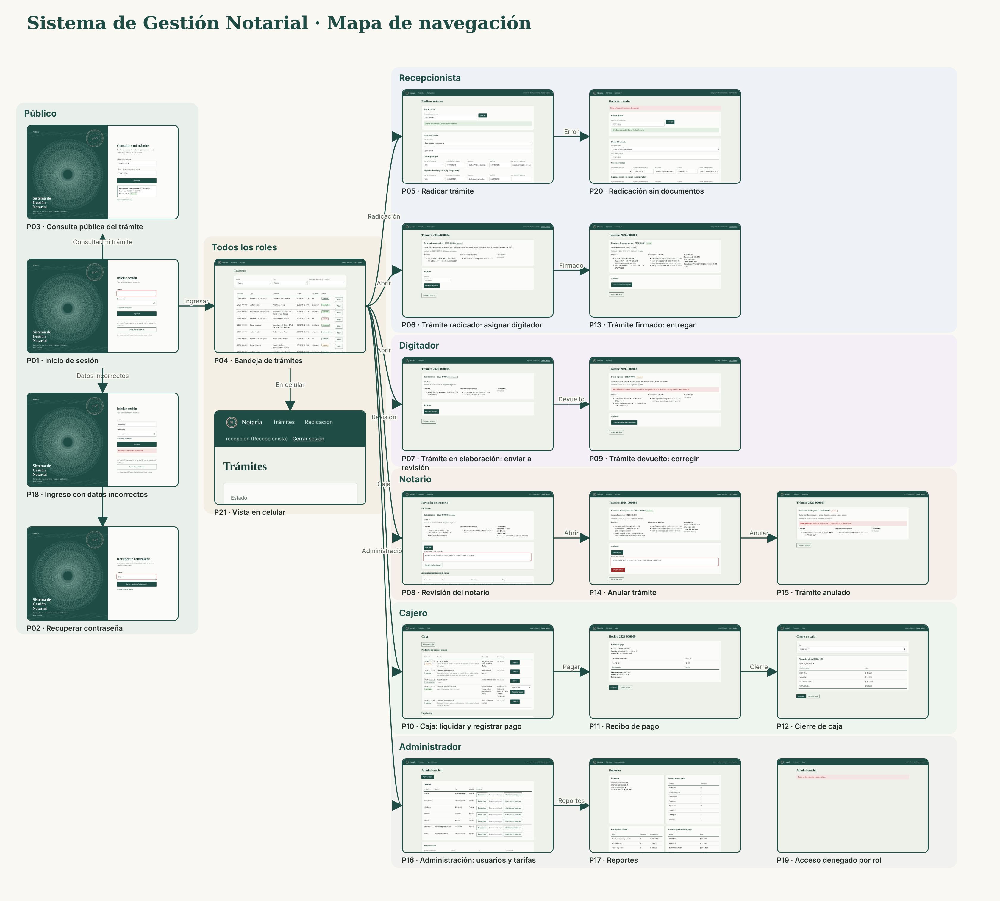

# Mockups · Sistema de Gestión Notarial

21 pantallas tomadas de la aplicación en React con datos de prueba. P01–P17 muestran el camino
principal de cada rol y P18–P21 los errores, el acceso denegado y la vista en celular.

Tablero en Miro (mapa de navegación y las 21 pantallas): https://miro.com/app/board/uXjVELcayXs=/

Mapa de navegación (cómo se pasa de una pantalla a otra según el rol): [mapa-de-navegacion.png](mapa-de-navegacion.png)

| Pantalla | Archivo | Historias de usuario |
|---|---|---|
| P01 Inicio de sesión | [P01-inicio-de-sesion.png](P01-inicio-de-sesion.png) | HU_001, HU_002 |
| P02 Recuperar contraseña | [P02-recuperar-contrasena.png](P02-recuperar-contrasena.png) | HU_003 |
| P03 Consulta pública del trámite | [P03-consulta-publica-del-tramite.png](P03-consulta-publica-del-tramite.png) | HU_020 |
| P04 Bandeja de trámites | [P04-bandeja-de-tramites.png](P04-bandeja-de-tramites.png) | HU_001, HU_002, HU_005, HU_010 |
| P05 Radicar trámite | [P05-radicar-tramite.png](P05-radicar-tramite.png) | HU_006, HU_007, HU_008, HU_009 |
| P06 Trámite radicado: asignar digitador | [P06-tramite-radicado-asignar-digitador.png](P06-tramite-radicado-asignar-digitador.png) | HU_008, HU_011, HU_012 |
| P07 Trámite en elaboración: enviar a revisión | [P07-tramite-en-elaboracion-enviar-a-revision.png](P07-tramite-en-elaboracion-enviar-a-revision.png) | HU_013 |
| P08 Revisión del notario | [P08-revision-del-notario.png](P08-revision-del-notario.png) | HU_014, HU_016 |
| P09 Trámite devuelto: corregir | [P09-tramite-devuelto-corregir.png](P09-tramite-devuelto-corregir.png) | HU_015 |
| P10 Caja: liquidar y registrar pago | [P10-caja-liquidar-y-registrar-pago.png](P10-caja-liquidar-y-registrar-pago.png) | HU_021, HU_022 |
| P11 Recibo de pago | [P11-recibo-de-pago.png](P11-recibo-de-pago.png) | HU_022 |
| P12 Cierre de caja | [P12-cierre-de-caja.png](P12-cierre-de-caja.png) | HU_023 |
| P13 Trámite firmado: entregar | [P13-tramite-firmado-entregar.png](P13-tramite-firmado-entregar.png) | HU_011, HU_017 |
| P14 Anular trámite | [P14-anular-tramite.png](P14-anular-tramite.png) | HU_018 |
| P15 Trámite anulado | [P15-tramite-anulado.png](P15-tramite-anulado.png) | HU_011, HU_018 |
| P16 Administración: usuarios y tarifas | [P16-administracion-usuarios-y-tarifas.png](P16-administracion-usuarios-y-tarifas.png) | HU_004, HU_024 |
| P17 Reportes | [P17-reportes.png](P17-reportes.png) | HU_025 |
| P18 Ingreso con datos incorrectos | [P18-ingreso-con-datos-incorrectos.png](P18-ingreso-con-datos-incorrectos.png) | HU_001 |
| P19 Acceso denegado por rol | [P19-acceso-denegado-por-rol.png](P19-acceso-denegado-por-rol.png) | HU_005 |
| P20 Radicación sin documentos | [P20-radicacion-sin-documentos.png](P20-radicacion-sin-documentos.png) | HU_009 |
| P21 Vista en celular | [P21-vista-en-celular.png](P21-vista-en-celular.png) | HU_010 |
